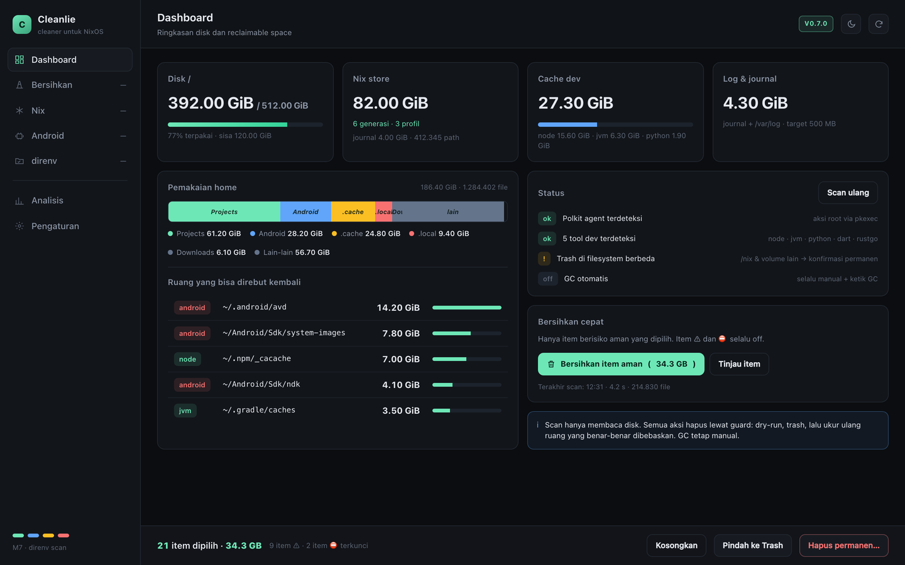
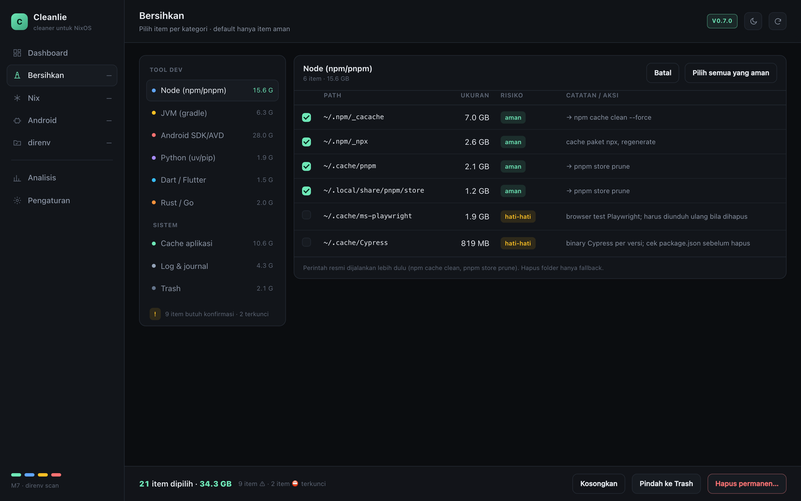
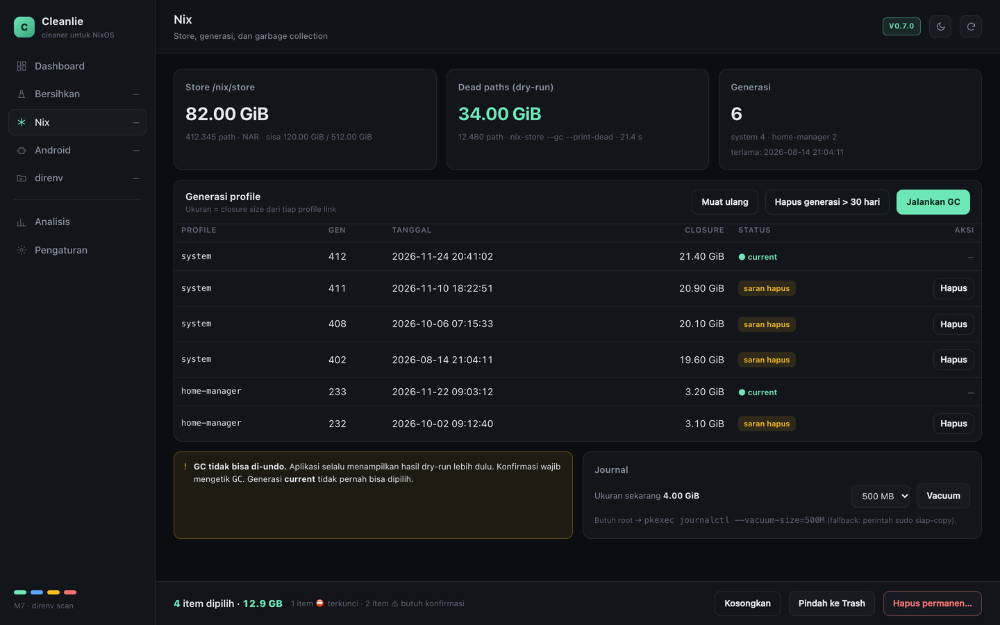
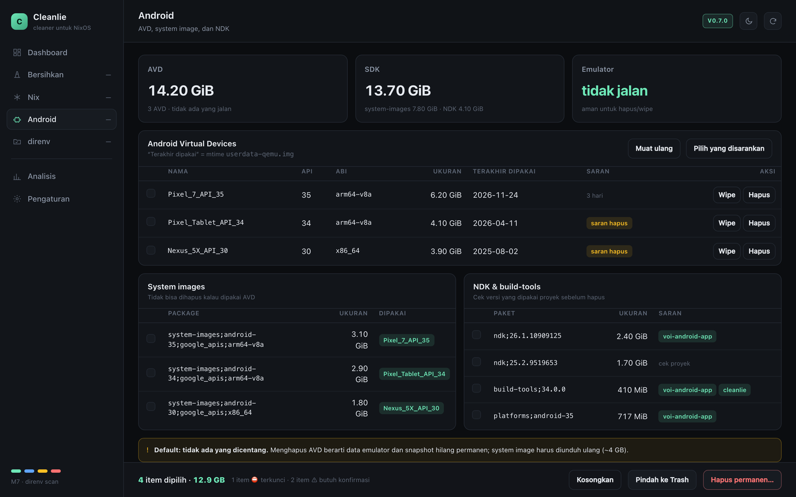
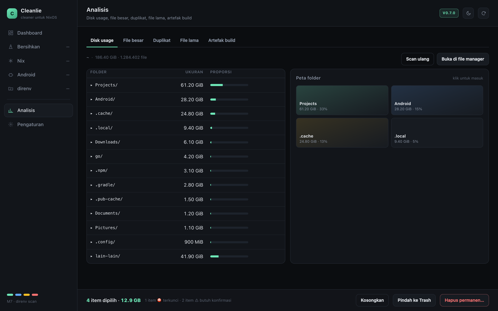
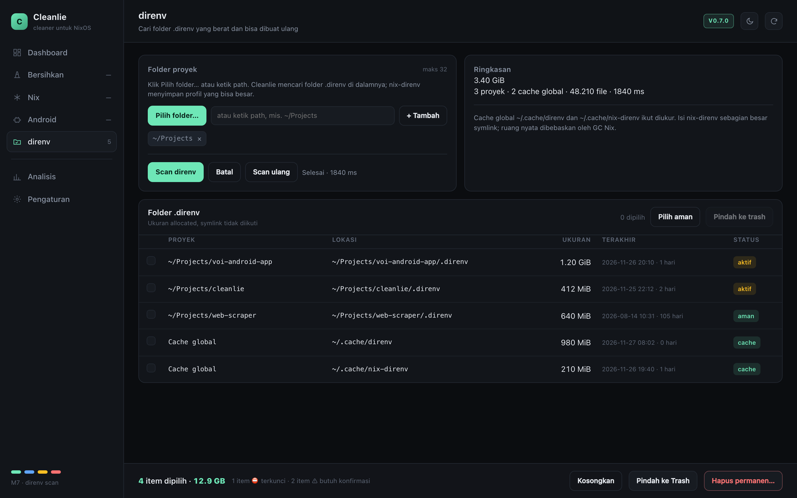
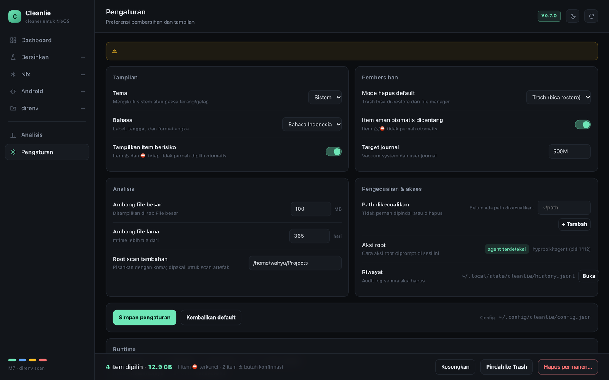

<p align="center">
  
</p>

<h1 align="center">Cleanlie</h1>

<p align="center">
  <b>Disk cleaner untuk mesin dev yang serius.</b><br>
  Nix store, cache tool, Android SDK, direnv, dan file besar — terlihat, terukur,
  dan bisa dibersihkan tanpa <code>rm -rf</code> buta.
</p>

<p align="center">
  Go + Wails v2 · UI statis (tanpa Node) · Linux/NixOS & macOS · dry-run + trash · audit log
</p>

---

Cleanlie menjawab satu pertanyaan yang sering bikin malas bersih-bersih:
**"80 GB di disk ini, punyaku yang mana?"**

Alih-alih menebak folder, Cleanlie memetakan pemakaian disk, mencocokkannya dengan
katalog rule yang sadar-tool (npm, pnpm, Gradle, uv, pub, Go, Cargo, Android, Nix,
direnv), lalu menunjukkan mana yang aman dibuang, mana yang butuh konfirmasi, dan
mana yang sedang dipakai proses berjalan.

Semua aksi default-nya **dry-run** dan **trash** — bisa di-restore. Ukuran yang
dihapus diukur ulang, bukan diasumsikan.

## Kenapa Cleanlie

- **Satu dashboard, bukan sepuluh `du -sh`.** Disk, Nix store, cache dev, journal,
  dan pemakaian home dalam satu layar.
- **Sadar tool, bukan sekadar folder besar.** Tahu bedanya `~/.npm/_cacache`
  (aman) dengan `node_modules` proyek yang sedang jalan (jangan disentuh).
- **Nix-native.** Generasi, closure, dead paths, GC, dan vacuum journal — dengan
  guard yang mengerti profile dan generasi `current`.
- **Android SDK/AVD ikut kelihatan.** AVD jarang dipakai, system image yatim, NDK
  dan build-tools lama: semua ada ukurannya.
- **direnv & nix-direnv.** Cache `.direnv` per proyek plus cache global, dengan
  penanda proyek yang masih aktif.
- **Aman by default.** Trash dulu, whitelist root, protected path, proses berjalan
  di-skip, dan konfirmasi ketik `GC` untuk aksi Nix.
- **Native di kedua platform.** Linux memakai polkit + systemd journal; macOS
  memakai prompt admin `osascript`, katalog `~/Library`, dan Trash Finder.
- **Bisa diotomasi.** Mode headless `--json` untuk CI, cron, atau sekadar cek
  sebelum update.
- **Akurat.** Tree disk usage dibandingkan dengan `du` (selisih ±0,001% pada mesin
  uji); ukuran memakai blok disk, bukan panjang file.

## Sekilas

| **Bersihkan** | **Nix** |
| --- | --- |
|  |  |
| **Android** | **Analisis** |
|  |  |
| **direnv** | **Pengaturan** |
|  |  |

## Fitur

### Bersihkan
Katalog rule per ekosistem: Node (npm/npx/pnpm), JVM (Gradle/Maven), Python
(uv/pip), Dart/Flutter, Rust/Go, Android, cache aplikasi, log/journal, dan trash.
Tiap item punya ukuran, tingkat risiko, dan perintah resmi yang disarankan
(`npm cache clean`, `uv cache prune`, `go clean -cache`, …). Pilih item → lihat
ringkasan → konfirmasi → masuk trash.

### Nix
Ukuran store dan jumlah path, dead paths dari `nix-store --gc --print-dead`,
daftar generasi per profile (system, home-manager, user) beserta closure dan umur,
saran hapus untuk generasi lama, GC, dan vacuum journal ke target. Aksi root lewat
polkit (`pkexec`) bila tersedia; kalau tidak, perintah `sudo` siap-copy ditampilkan
dan tidak dieksekusi diam-diam.

### Android
AVD dengan API, ABI, ukuran, dan "terakhir dipakai"; system image beserta AVD yang
memakainya; NDK, build-tools, dan platform. Hapus AVD lewat `avdmanager`, uninstall
paket lewat `sdkmanager`, wipe data lewat `emulator -wipe-data` — semuanya ditolak
saat emulator sedang berjalan. UI mengirim nama AVD/ID paket, bukan path.

### Analisis
Tree disk usage interaktif dengan peta proporsi, file terbesar, file lama, artefak
build (`node_modules`, `target`, `build`, `dist`, `.direnv`, …), dan pencarian
duplikat berbasis hash. Read-only saat memindai; tombol trash memakai guard yang
sama dengan layar Bersihkan.

### direnv
Cari folder `.direnv` di root proyek pilihanmu, hitung ukurannya, tandai proyek
yang masih aktif, dan bersihkan cache global `direnv`/`nix-direnv` yang menumpuk.

### Dashboard & Pengaturan
Ringkasan disk, Nix, cache, log, dan home; tema system/light/dark; i18n ID/EN;
ambang file besar/lama; root scan tambahan; dan daftar pengecualian yang tidak
pernah dipindai maupun dihapus.

## Keamanan

1. **Dry-run dulu.** Eksekusi hanya dari plan yang sudah ditampilkan.
2. **Trash default.** `gio trash` di Linux / `~/.Trash` di macOS (bisa restore);
   permanen harus dicentang eksplisit.
3. **Whitelist + protected path.** Item di luar aturan ditolak, bukan "dilewati diam-diam".
4. **Proses berjalan di-skip.** Cache tool yang sedang dipakai tidak dipaksa hapus.
5. **Generasi Nix `current` tidak pernah bisa dipilih.** GC/hapus generasi wajib konfirmasi ketik `GC`.
6. **`freed` diukur ulang** (before − after) dan dicatat di `~/.local/state/cleanlie/history.jsonl`.
7. **Aksi root eksplisit.** `pkexec` (Linux) atau dialog `osascript` (macOS) dengan
   path absolut; tanpa agent, perintah `sudo` hanya ditampilkan.
8. **Path pengecualian dijaga dua kali** — saat scan dan saat `Clean`.

## Mulai

Butuh Nix dengan flakes. Dev shell Linux membawa Go, Wails, GTK3, WebKitGTK,
Node, dan jq; dev shell macOS membawa Go, Wails, Node, dan jq (WKWebView dari
sistem).

```sh
git clone https://github.com/WahyuSetiawan/Clean-Lie
cd Clean-Lie
direnv allow        # sekali saja; butuh direnv + nix-direnv
make dev            # wails dev, hot reload
```

Tanpa shell interaktif:

```sh
nix develop -c make build
./bin/cleanlie
```

Atau langsung sebagai paket:

```sh
nix build .#cleanlie
./result/bin/cleanlie

nix profile install .#cleanlie
# lalu jalankan "Cleanlie" dari launcher
```

`make build` menghasilkan `bin/cleanlie`, `make run` build + jalankan, dan
`make test` menjalankan seluruh test Go.

### macOS

Dev shell `aarch64-darwin` tidak memuat GTK/WebKitGTK karena Wails memakai WKWebView
sistem. Isinya `go`, `gopls`, `wails` 2.17.1, `node`, dan `jq`.

```sh
direnv allow
make build     # bin/cleanlie
make test
make app       # Cleanlie.app via `wails build`
```

Yang berbeda di macOS:

- **Aksi root** memakai dialog admin native `osascript` (setara `pkexec`). Kalau
  prompt dibatalkan, UI menampilkan perintah `sudo` siap-copy.
- **Katalog clean** menambahkan `~/Library/Caches`, `~/Library/Logs`,
  `~/Library/Developer/Xcode` (DerivedData, iOS DeviceSupport, Archives),
  CoreSimulator, cache Homebrew, serta cache tool dev di `~/Library` (Go, gopls,
  uv, pip, pnpm, Playwright, Cypress). Rule journal/`/var/log` tidak dimuat.
- **Trash** memakai `~/.Trash` Finder (tanpa `.trashinfo`).
- **Guard proses** membaca `ps` (tanpa `/proc`), jadi cache aplikasi yang sedang
  berjalan tetap diblokir.
- **Layar Nix** tetap ada bila Nix terpasang; kartu journal disembunyikan.

`nix build .#cleanlie` tetap Linux-only (butuh GTK3, WebKitGTK, systemd, polkit);
di macOS pakai `make build`/`make app`.

## Pakai di NixOS

Flake ini mengekspor `packages.<system>.cleanlie`, `overlays.default`, dan
`nixosModules.default`.

```nix
inputs.cleanlie.url = "github:WahyuSetiawan/Clean-Lie";
```

Pilih salah satu:

```nix
# 1. overlay
flake.overlays.cleanlie = inputs.cleanlie.overlays.default;
environment.systemPackages = [ pkgs.cleanlie ];

# 2. langsung dari input
environment.systemPackages = [
  inputs.cleanlie.packages.${pkgs.stdenv.hostPlatform.system}.default
];

# 3. modul NixOS (overlay + package sekaligus)
imports = [ inputs.cleanlie.nixosModules.default ];
```

Setelah menambah input, jalankan `nix flake lock`. Update Cleanlie saja:
`nix flake update cleanlie`.

Paket memasang desktop entry dan ikon:
`result/share/applications/cleanlie.desktop`,
`result/share/icons/hicolor/scalable/apps/cleanlie.svg`. Wrapper membawa PATH untuk
`nix`, `journalctl`, `pkexec`, `gio`, dan `xdg-open` (karena `pkexec` membuang
environment sesi).

## Headless (tanpa GUI)

Semua mode berikut **read-only** dan mengeluarkan JSON:

```sh
./bin/cleanlie --dry-run                 # laporan teks, tidak menghapus
./bin/cleanlie --dry-run --json          # JSON untuk integrasi
./bin/cleanlie --scan-only --path DIR    # ukur satu direktori
./bin/cleanlie --nix-status              # store, generasi, journal
./bin/cleanlie --nix-dead                # dry-run GC: jumlah + ukuran dead path
./bin/cleanlie --android-status          # AVD + paket SDK
./bin/cleanlie --analysis-tree           # tree disk usage (--path, --depth)
./bin/cleanlie --analysis-overview       # file besar/lama/artefak
./bin/cleanlie --analysis-dups           # file duplikat
./bin/cleanlie --direnv-scan --path DIR  # folder .direnv di DIR
./bin/cleanlie --version

make verify                              # bandingkan ukuran vs `du` (toleransi 2%)
```

Contoh cron mingguan yang cuma melapor:

```sh
./bin/cleanlie --dry-run --json > /var/log/cleanlie.json
```

Eksekusi hapus ada di GUI: pilih item → konfirmasi → trash/perm. Hasilnya menyimpan
`freed` terukur dan audit log, jadi kamu bisa melihat apa yang pernah dibuang.

## Test

```sh
make test                                  # Go: unit + integrasi
cd frontend/test && npm install && npm test # jsdom: alur UI dengan binding tiruan
```

Test UI menjalankan `frontend/dist/index.html` dengan `window.go` tiruan: scan →
pilih → gate permanen → trash → hasil, Nix → gate `GC`, Android → hapus/uninstall/
wipe, dashboard, analisis (tree, drill-down, duplikat, artefak), dan direnv.
Ini juga menjaga agar binding Wails tidak tertimpa.

Screenshot README dibuat ulang secara deterministik dari UI yang sama:

```sh
node docs/screenshots/harness/shoot.mjs   # butuh Chromium/Brave + ImageMagick
```

Harness mengisi `window.go` dengan data contoh (bukan data mesin siapa pun), jadi
gambarnya bisa di-regenerate kapan saja tanpa membocorkan path pribadi.

## Struktur

```
main.go                 # wails.Run + embed frontend/dist + dispatch CLI
cli.go                  # --dry-run / --json / Nix / Android / analisis / direnv
app.go                  # binding Go → window.go.main.App
app_clean.go            # ScanJunk/CancelScan/Clean/History
app_nix.go              # NixStatus/NixDeadPaths/NixPreview + aksi
app_android.go          # AndroidStatus/Refresh/DeleteAVD/Uninstall/Wipe
app_analysis.go         # tree/overview/duplikat + trash analisis
app_direnv.go           # scan .direnv + cache global + root config
app_settings.go         # Settings/SaveSettings/ResetSettings
internal/fsx/           # walker paralel (blok disk, hardlink, one-fs)
internal/rules/         # katalog rule + plan read-only
internal/clean/         # guard, trash freedesktop, deteksi proses, audit
internal/nix/           # generasi, closure, dead paths, GC/vacuum
internal/android/       # parser AVD/SDK + aksi resmi
internal/analysis/      # tree, file besar/lama, artefak, duplikat
internal/direnv/        # .direnv per proyek + cache global
internal/config/        # config.json
internal/privileged/    # pkexec + fallback sudo siap-copy
internal/tools/         # eksekusi perintah resmi + preview + timeout
frontend/dist/          # UI statis (tanpa build Node)
frontend/test/          # smoke test jsdom
packaging/              # desktop entry + ikon
flake.nix|package.nix   # devShell, package, overlay, nixosModules
docs/                   # plan, task, wireframe, implementation, screenshot
```

## Dokumentasi

- [`docs/tasks/cleanlie-v1.md`](docs/tasks/cleanlie-v1.md) — rencana & gate v1
- [`docs/implementation/`](docs/implementation/) — catatan implementasi M1–M7
- [`CHANGELOG.md`](CHANGELOG.md) — riwayat perubahan

## Platform

- **Linux/NixOS** — target utama: GTK3 + WebKitGTK, polkit, systemd journal,
  paket Nix (`nix build .#cleanlie`), dan modul NixOS.
- **macOS (aarch64)** — WKWebView, `osascript`, katalog `~/Library`, dan Trash
  Finder; build lewat `make build`/`make app`.

Di Wayland/Hyprland, GTK3/WebKitGTK bisa melaporkan viewport negatif setelah window
di-tile; binary otomatis memakai XWayland bila `WAYLAND_DISPLAY` dan `DISPLAY`
tersedia. Set `GDK_BACKEND=wayland` untuk memaksa Wayland
(`WEBKIT_DISABLE_COMPOSITING_MODE=1` sudah diset di devShell).

## Lisensi

Belum ditentukan.
